<picture>
  <source media="(max-width: 600px) and (prefers-color-scheme: dark)" srcset="assets/banner-mobile-dark.svg">
  <source media="(max-width: 600px) and (prefers-color-scheme: light)" srcset="assets/banner-mobile-light.svg">
  <source media="(prefers-color-scheme: dark)" srcset="assets/banner-dark.svg">
  <source media="(prefers-color-scheme: light)" srcset="assets/banner-light.svg">
  
</picture>

## About

I'm a software engineer based in Algiers. I work across the stack — typed frontends, APIs, and systems tooling — with a focus on clear architecture, reliable behavior, and interfaces that stay out of the way.

## Selected work

| Project | What it does | Stack |
|:--|:--|:--|
| **[Nimbus](https://github.com/dzdzdzdzdzdz213/nimbus)** | A real-time system monitor that maps CPU, memory, and disk activity to a live weather simulation. | `PowerShell` |
| **[Strata](https://github.com/dzdzdzdzdzdz213/strata)** | A filesystem visualization that renders directories as geological strata, revealing composition and age at a glance. | `PowerShell` |
| **[Synesthesia](https://github.com/dzdzdzdzdzdz213/synesthesia)** | A cross-sensory system portrait that translates live metrics into color, rhythm, texture, and scent. | `PowerShell` |
| **[Golem](https://github.com/dzdzdzdzdzdz213/golem)** | A boot-time journaling daemon that writes reflective entries from system logs, file activity, and network state. | `PowerShell` |
| **[PassShield](https://github.com/dzdzdzdzdzdz213/passshield)** | A full-stack password security platform with breach detection, entropy scoring, secure generation, and an admin dashboard. | `TypeScript` · `Python` · `Flask` |

### In development

**NEON** — a browser-based neuroevolution sandbox where organisms learn to forage through selection and mutation. 
`HTML` · `JavaScript`

## Technical stack

- **Languages:** TypeScript, JavaScript, Python, C, Java, PowerShell
- **Frontend:** React, Next.js, Tailwind CSS
- **Backend:** Node.js, Express, Flask, REST APIs
- **Data:** PostgreSQL, MySQL, Supabase
- **Tools:** Git, GitHub

## Contact

- **Email:** [aimenmamache21@gmail.com](mailto:aimenmamache21@gmail.com)
- **GitHub:** [@dzdzdzdzdzdz213](https://github.com/dzdzdzdzdzdz213)

 

  Based in Algiers, Algeria · 36.7538° N, 3.0588° E

