<picture>
  <source media="(max-width: 600px) and (prefers-color-scheme: dark)" srcset="assets/profile-mobile-dark.svg">
  <source media="(max-width: 600px) and (prefers-color-scheme: light)" srcset="assets/profile-mobile-light.svg">
  <source media="(prefers-color-scheme: dark)" srcset="assets/profile-dark.svg">
  <source media="(prefers-color-scheme: light)" srcset="assets/profile-light.svg">
  
</picture>

## About

I'm an IT professional based in Algiers with a strong interest in artificial intelligence and data analysis. My background spans infrastructure, APIs, and frontends, and I care about building systems that are clear, reliable, and useful.

I turn raw data into clear answers — cleaning it, exploring it, and presenting what matters.

## Technical stack

- **Languages:** Python, SQL, TypeScript, JavaScript, C, Java, PowerShell
- **Data analysis:** Pandas, NumPy, Matplotlib, Jupyter, Excel
- **AI/ML:** Python, scikit-learn
- **Frontend:** React, Next.js, Tailwind CSS
- **Backend:** Node.js, Express, Flask, REST APIs
- **Databases:** PostgreSQL, MySQL, Supabase
- **Tools:** Git, GitHub

## Contact

- **Email:** [aimenmamache21@gmail.com](mailto:aimenmamache21@gmail.com)
- **GitHub:** [@dzdzdzdzdzdz213](https://github.com/dzdzdzdzdzdz213)

 

  Based in Algiers, Algeria · 36.7538° N, 3.0588° E

